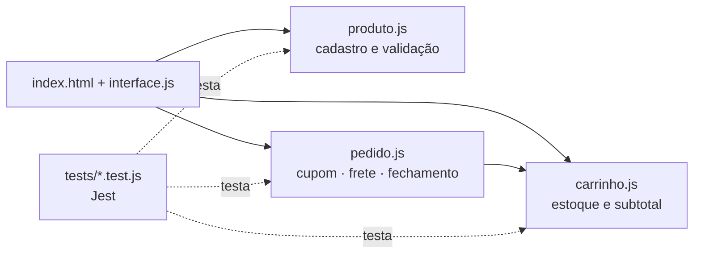

<h1 align="center">Gestão de Pedidos · Loja Online</h1>

<p align="center">
  <b>Regras de negócio de um e-commerce (produtos, carrinho, cupons, frete e fechamento de pedido) validadas com 51 testes unitários em Jest.</b>
</p>

<p align="center">
  
  
  
  
</p>

<p align="center">
  <a href="#-como-rodar-localmente">Rodar localmente</a> ·
  <a href="#-testes">Testes</a> ·
  <a href="#-decisões-técnicas">Decisões técnicas</a>
</p>

---

## 🎯 O problema

Em uma loja online, um erro de regra de negócio custa dinheiro: estoque negativo, desconto aplicado em dobro, frete cobrado errado ou pedido fechado com carrinho vazio. O desafio era **implementar essas regras e provar, com testes automatizados, que elas se comportam como esperado**, incluindo os casos de erro.

> Projeto da disciplina **Teste de Software** (N1 AT2, Ciência da Computação, UCB).

## ✅ A solução

Módulos JavaScript separados por responsabilidade (`produto`, `carrinho`, `pedido`) com uma interface web simples em HTML/CSS, e uma suíte de **51 testes unitários com 100% de cobertura** de instruções, branches, funções e linhas.

**Regras de negócio implementadas e testadas**

- **Produtos:** cadastro, edição, exclusão e busca por ID; bloqueia preço negativo, estoque negativo e campos obrigatórios ausentes.
- **Carrinho:** não deixa adicionar produto sem estoque ou acima do disponível; baixa o estoque ao adicionar e devolve ao remover; soma quantidades do mesmo item.
- **Cupons:** `DEZOFF` (10%) e `VINTEOFF` (20%); cupom inválido gera erro.
- **Frete:** grátis a partir de R$ 200; abaixo disso, R$ 10 para CEPs que começam com 7 e R$ 25 para os demais; CEP inválido gera erro.
- **Fechamento do pedido:** bloqueia carrinho vazio e dados do cliente incompletos.

## 📸 Demonstração

<!-- Adicione um print da interface (docs/img/interface.png) e do relatório de cobertura (docs/img/coverage.png) e descomente:
| Interface | Cobertura de testes |
|---|---|
|  |  |
-->
🎬 *Prints da interface e do relatório de cobertura em breve.*

## 🛠️ Tecnologias

| Camada | Tecnologia | Por que escolhi |
|---|---|---|
| Regras de negócio | JavaScript (Node.js, CommonJS) | Módulos puros, sem dependência de interface, fáceis de testar isoladamente. |
| Interface | HTML + CSS + JavaScript | Interface leve para demonstrar as regras no navegador, sem framework. |
| Testes | Jest | Testes unitários, *mocks* e relatório de cobertura na mesma ferramenta. |

## 🧱 Arquitetura



**Estrutura**

```
gestao_de_pedidos/
├── src/
│   ├── produto.js      # cadastro, edição, exclusão, busca e validações
│   ├── carrinho.js     # adicionar/remover itens, estoque e subtotal
│   └── pedido.js       # cupons, frete e fechamento do pedido
├── tests/
│   ├── produtos.test.js   # 23 casos
│   ├── carrinho.test.js   # 16 casos
│   └── pedido.test.js     # 12 casos
├── index.html · style.css · interface.js
```

## 💡 Decisões técnicas

- **Regras separadas da interface**: `produto`, `carrinho` e `pedido` não tocam no DOM, então podem ser testados sem navegador. A interface só chama essas funções.
- **Erros explícitos (`throw new Error`) em vez de retornos silenciosos**: cada violação de regra tem mensagem própria, e os testes verificam exatamente qual erro foi lançado.
- **Constantes para valores de negócio** (`CUPONS_VALIDOS`, `VALOR_MINIMO_FRETE_GRATIS`): mudar um cupom ou o limite do frete grátis é uma alteração em um lugar só.
- **Mock do subtotal no teste de fechamento de pedido**: isola a regra de fechamento do cálculo do carrinho, que já tem seus próprios testes.
- **Casos de teste numerados (CT-01, CT-02…)** e organizados por módulo, rastreáveis até o plano de testes da disciplina.

## 🧪 Testes

| Módulo | Arquivo | Casos | Exemplos |
|---|---|---|---|
| Produtos | `produtos.test.js` | 23 | campos obrigatórios, preço/estoque negativos, preço zero, busca por ID |
| Carrinho | `carrinho.test.js` | 16 | sem estoque, quantidade ≤ 0, baixa e devolução de estoque, subtotal |
| Pedido | `pedido.test.js` | 12 | cupons válidos/inválidos, faixas de frete, CEP inválido, carrinho vazio |
| **Total** | | **51** | **51 aprovados · 100% de cobertura** (statements, branches, functions, lines) |

```bash
npx jest              # roda os testes
npx jest --coverage   # roda e gera o relatório de cobertura
```

## 🚀 Como rodar localmente

**Pré-requisito:** Node.js 18+.

```bash
git clone https://github.com/diegoomarcelo/gestao_de_pedidos.git
cd gestao_de_pedidos
npx jest --coverage
```

Para usar a interface, abra o `index.html` no navegador.

## 🗺️ Próximos passos

- [ ] Adicionar `package.json` com Jest como dependência de desenvolvimento e script `npm test`.
- [ ] Rodar os testes automaticamente a cada push com GitHub Actions.

## 👤 Autor

**Diego Marcelo**, Desenvolvimento de Software e Dados
[LinkedIn](https://linkedin.com/in/diegomarcelo) · [GitHub](https://github.com/diegoomarcelo) · diegoomarcelo@gmail.com
